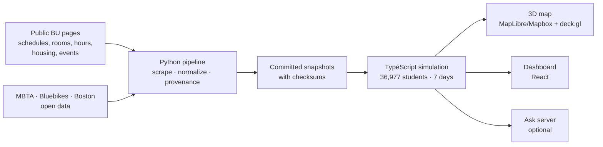

<div align="center">

<picture>
  <source media="(prefers-color-scheme: dark)" srcset="docs/images/logo-dark.png">
  
</picture>

**See how crowded BU will be before you get there.**

A live 3D model of Boston University where 36,977 simulated students follow the university's real published class schedules, so anyone can see which dining halls, libraries, gyms and buildings will be packed, hour by hour, and how campus events and emergencies change that.


</div>

## Why this matters

A campus is a small city of 48,000 people (37,000 students and 11,000 staff) sharing the same sidewalks, dining halls and libraries. Crowding isn't just annoying:

- **Students lose time and calm.** The 12:20 lunch rush, a full library before an exam, a crowded walk between back-to-back classes. For students with anxiety, sensory sensitivities or mobility needs, knowing where it's quiet is the difference between going and staying home.
- **Safety depends on knowing where people are.** During a fire drill or a building closure, where do thousands of students go next? Today nobody can answer that before it happens.
- **Planners fly blind.** Event organizers, dining services and facilities have no shared, open picture of how a schedule change ripples across campus.

The data that could answer these questions is already public, but it's scattered across dozens of BU pages: class schedules, classroom seat counts, dining and library hours, residence-hall capacities, event listings, MBTA timetables. **Flowcast pulls it together, runs a transparent simulation on it, and shows the result in a browser, free, with no login.**

## Highlights

| | |
| --- | --- |
| 🏫 **3 campuses, 101 places** | Charles River, Fenway and Medical, with detailed 3D building models |
| 👥 **36,977 simulated students** | Matching BU's Fall 2025 census by level and full/part-time status |
| 📚 **5,904 real class meetings** | From BU's public Fall 2026 schedule, in 437 classrooms with published seat counts |
| 🎟️ **88 real campus events** | Every public Terrier Central event; 55 at mapped places change crowding on the map |
| 🚇 **Live transit** | MBTA Green Line and buses, BU Shuttle and Bluebikes, live and from published timetables |
| 🚒 **What-if emergencies** | Fire drills, alarms and closures: watch occupants evacuate and choose where to go next |
| 🔍 **Honest by design** | Every number is labelled as published evidence or a model assumption, with its source |
| ♿ **Accessible** | Crowd levels always use a word and a percentage, never colour alone; full keyboard support |

## What you can do with it

### Watch the campus move

Students walk real pedestrian routes between classes, meals, study and the gym. Each building glows by how full it is, and its tag shows a level word and percentage. Scrub the timeline, play at up to 600× speed, or switch to **Clock** mode to follow the real time in Boston.


### Plan around campus events

Flowcast collects all of BU's public events and resolves each venue to a mapped building. During an event, students who are free attend it, up to the room's published seat count, and the venue lights up on the map. Events whose location is login-only or unmapped are still listed, with the reason they can't affect the map.


The **Event impact** tab answers a simple question: *"If I go to campus on this date, what will be different?"* Pick any date on the calendar to see that day's events and, for every place, hour-by-hour crowding with and without the events.


### Rehearse emergencies before they happen

Start a fire drill, alarm or building closure on any building. Occupants evacuate, gather, and then choose a feasible next place. Classes stay where they're scheduled; meals and study move to venues that are open and have room. Unplanned alarms bring a Boston Fire response to the building. Everything is compared against the normal day, so facilities and safety staff can see where the overflow goes.


### A student dashboard that answers "where should I go?"

Today's schedule, crowd forecasts for your places, nearby events and clubs, and a plain-language **Ask** chat: *"Least crowded library right now"*, *"Quietest dining hall at 6 PM"*, *"How far is CS 132 from DS 340?"* Answers come from the same simulation and walking routes the map uses. Both the dashboard and map Ask tab keep a conversation, so you can follow up with “How far is it from CAS?” or start over with **New chat**.

| Home | Events |
| --- | --- |
|  |  |

## Who benefits and how it scales

| Who | What Flowcast gives them |
| --- | --- |
| **Students** | Avoid the rush, find a quiet study spot, see how an event changes a building, plan accessible walks |
| **Event organizers and clubs** | See which rooms and times won't collide with peak crowds |
| **Dining, libraries, recreation** | An hour-by-hour picture of expected demand, built only from public schedules |
| **Safety and facilities** | Rehearse drills and closures and see where thousands of people go next |
| **The City of Boston and MBTA** | Student flows onto Comm Ave sidewalks, Green Line stops and Bluebikes docks |

**Beyond BU:** every input is something most universities already publish: course schedules, room capacities, opening hours, event calendars and public transit feeds. The pipeline records where each value came from, so another campus can swap in its own pages. The same approach applies to any public venue with a schedule: hospitals, convention centers, stadium districts.

## Honest by design

A civic tool has to be trustworthy, so Flowcast never passes a guess off as a fact:

- **Published versus modeled.** Class times, seat counts, hours and bed counts are published; enrollment, meals, study and event attendance are named, tunable assumptions. The app labels which is which.
- **Never invented.** No made-up venues, capacities or coordinates. Event registrations are never treated as attendance. Private events are skipped, not parsed.
- **Checked against reality.** We compare the simulation with every real count we could find, including the gaps:

| Real observation | Simulated | Observed | Ratio |
| --- | ---: | ---: | --- |
| FitRec visits, Saturday (hourly, Oct 2026) | 2,500 | 2,510 | 100% |
| FitRec visits, weekday | 1,465 | 3,913 | 37%: staff aren't simulated yet |
| West Campus Dining meals per day | 3,098 | 3,000–5,000 | in range |
| Warren Dining meals per day | 2,722 | 3,850 | 71% |
| Comm Ave at Silber Way, 5–6 PM walkers | 1,547 | 1,818 (2023) | 85% |
| Comm Ave at Granby St, 5–6 PM walkers | 1,572 | 1,995 (2023) | 79% |

The gaps point to the next steps on our roadmap: add BU's 11,140 employees, and fit behavior rates to these counts instead of setting them by hand.

## Built with Kiro

We built Flowcast with Kiro's spec-driven workflow, and the `.kiro/` folder shows how:

| Kiro feature | In this repo |
| --- | --- |
| **Specs** | [`campus-events`](.kiro/specs/campus-events/) and [`student-fatigue`](.kiro/specs/student-fatigue/): EARS requirements → design → tasks, ticked only after tests prove them |
| **Steering** | [`product`](.kiro/steering/product.md), [`tech`](.kiro/steering/tech.md), [`structure`](.kiro/steering/structure.md) and [`fatigue-model`](.kiro/steering/fatigue-model.md): data-honesty and determinism rules that every session follows |
| **Custom agents** | [`flowcast`](.kiro/agents/flowcast.json) (whole project) and [`fatigue-modeler`](.kiro/agents/fatigue-modeler.json) (scoped write access) |
| **Agent hooks** | Start: open tasks and git state · After each write: catch data snapshots changed without a checksum update · Stop: tests and typechecks |
| **Skills** | `/refresh-events`, `/spec`, `/fatigue-calibration` |
| **Property-based testing** | 100 generated event days per run; it caught a real bug where events in classrooms could push a building over capacity |

Read the full story, including what Kiro caught that we would have missed, in **[docs/kiro-features.md](docs/kiro-features.md)**.

## Try it

Requirements: **Node.js 22+**, **Python 3.10+**, and **PostgreSQL** for the dashboard. The public map uses free OpenFreeMap tiles and needs no account or API key.

```bash
git clone https://github.com/Darkest-Teddy/Flowcast.git
cd Flowcast
(cd map-client && npm install)
(cd web && npm install)
(cd server && npm install)
npm --prefix map-client run prepare:data   # builds browser data offline from the committed snapshots
cp .env.example .env                       # fill in DATABASE_URL (and the rest when you have them)
# Start the API in a separate terminal. It creates its tables and loads the data itself:
(cd server && npm start)                   # http://127.0.0.1:8787
# Then start the browser app:
npm --prefix web run dev                   # http://localhost:5174
```

| Open | URL |
| --- | --- |
| Dashboard | http://localhost:5174 (dashboard sessions and saved preferences require the PostgreSQL API) |
| Event impact | http://localhost:5174/event-impact?date=2026-10-29 |
| 3D map | http://localhost:5174/map (first load takes about 20 seconds while the week is simulated) |
| Map during an evening event | http://localhost:5174/map?date=2026-10-29&at=20:15&speed=1 |

**Configuration** lives in one file: copy [`.env.example`](.env.example) to `.env` at the repo root (gitignored). The server, `npm start` and the web dev server all read it; `server/.env` and `map-client/.env.local` still work and win where they overlap. `npm run doctor` checks every value.

**Optional keys:** `VITE_MAPBOX_TOKEN` for textured Mapbox buildings, `VITE_MBTA_API_KEY` for a higher MBTA rate limit.

**Ask with the agent (optional):** the map's Ask tab and the dashboard's Ask Flowcast send campus questions to the Ask server in `server/`, which holds the OpenAI key. Put `OPENAI_KEY=...` in `.env` (gitignored, `chmod 600`), then run it next to the web app in two terminals:

```bash
npm --prefix server install && npm --prefix server start   # http://127.0.0.1:8787
npm --prefix web run dev
```

The web dev server forwards `/api/dashboard`, `/api/chat`, `/api/ask`, `/api/voice` and `/api/health` to it (set `FLOWCAST_API_URL` for another address). Without the server or a key, both pages answer on the device and say so. Questions about your own schedule are always answered on the device. See [server/README.md](server/README.md).

### Deploy (Railway)

1. **Railway:** create a project from this repo (it reads `railway.json`: `npm run build`, then `npm start`). Add a **PostgreSQL** service. Under **Settings → Networking**, generate a domain.
2. **Variables** on the Flowcast service, all listed in [`.env.example`](.env.example): `DATABASE_URL` = `${{Postgres.DATABASE_URL}}`, `SUPABASE_URL`, `SUPABASE_PUBLISHABLE_KEY`, and optionally `OPENAI_KEY` and `VITE_MAPBOX_TOKEN`. The server creates its tables and loads the data on every start; there is no migration step.
3. **Run `railway run npm run doctor`** (or `npm run doctor https://your-domain` locally). It checks each value, confirms Google is switched on in Supabase, and prints exactly what to paste into Google Cloud (consent screen and OAuth client) and Supabase (provider and URL configuration).
4. **Paste those in**, redeploy, and open the domain.

The same works on any machine: put the variables in `.env`, then `npm run build && npm start` (port 8080).

### PostgreSQL and production hosting

Keep `DATABASE_URL` in the backend's secret environment (for example, a Railway PostgreSQL connection variable). Never use a `VITE_` prefix or put database credentials in browser code. The browser only calls same-origin `/api/*`; cookies pass through the host to the API.

On start, the API applies its migrations and imports the prepared `map-client/public/data` sources, skipping the import when that data is already current. Both are idempotent and lock against each other. `npm run db:migrate` and `npm run db:import` in `server/` still run them by hand.

The root host binds to `HOST` (default `0.0.0.0`) and `PORT` (default `8080`). When `DATABASE_URL` is set and `FLOWCAST_API_URL` is unset, it starts `server/src/index.ts` as a child process bound to `127.0.0.1:8787`. `FLOWCAST_API_PORT` overrides that internal port; it must differ from the root host's port. If the root uses port 8787, the internal default is 8788. Root startup reads `.env` if present (the process environment wins) and passes the variables to the child without printing secrets. Stop the root process to stop its child.

For an independently managed API, set `FLOWCAST_API_URL` to its HTTP(S) origin. This disables local API startup; configure `DATABASE_URL` on that separate API process. Do not put credentials in the API URL. The root host forwards only `/api/dashboard` and `/api/chat` and their subpaths, `/api/ask`, `/api/health`, and `POST /api/voice/session`. It preserves request bodies, response statuses, cookies, `Host`, and `Origin`. Unknown `/api/*` paths return JSON 404; unavailable APIs return sanitized JSON 503 with a 30-second request deadline. Once response headers have been sent, an upstream failure closes the response. API errors never fall through to dashboard HTML. The public map remains available without PostgreSQL.

Both Vite apps use the same API target, defaulting to `http://127.0.0.1:8787`. For example, start the backend with `HOST=127.0.0.1 PORT=8798`, then run `FLOWCAST_API_URL=http://127.0.0.1:8798 npm --prefix web run dev -- --port 5198`. Both proxies preserve the browser-facing `Host`, so the backend can compare it with `Origin` for same-origin mutation checks.

Railway uses the repository root, `npm run build`, and `npm start` from `railway.json`. The configured `/` health check proves static hosting only; check `/api/health` and a dashboard request separately to verify API availability.

Google sign-in uses Supabase Auth. Set `SUPABASE_URL` and `SUPABASE_PUBLISHABLE_KEY`
(or `SUPABASE_ANON_KEY`) on the backend, alongside `DATABASE_URL`. The public configuration
is served at `/api/dashboard/auth/config`; never use a secret or service-role key there.
Google's OAuth client sends people back to `https://<project-ref>.supabase.co/auth/v1/callback`,
and Supabase sends them on to each Flowcast origin's `/auth/callback`; `npm run doctor` prints
both for your address. Profile access is tied to the verified Supabase user; Google login does
not grant access to Google Calendar.

### Import a class schedule

Open **Calendars** and upload an `.ics` export (up to 1 MB). Preview the next 120 days,
select classes, and match room names to campus buildings before importing. A new import replaces
only your imported schedule; it does not connect or change Google Calendar. Reimport when your
classes change. The imported schedule is saved to your signed-in account and included in your
data export.

Home shows your next class and a leave-by time using saved campus walking routes at 1.4 m/s,
rounded up to whole minutes, plus an arrival buffer (5 minutes by default). Confirm the **From**
building: it starts from your earlier class or profile home, not GPS. Unmapped buildings and
missing routes do not receive guessed departure times. Schedule times are shown in Boston time.


**Run the tests:**

```bash
(cd data-pipeline && python3 -m venv .venv && .venv/bin/pip install -r requirements.txt && .venv/bin/python -m unittest discover -s tests)
npm --prefix map-client test
npm run test:host
```

## How it works



- **`data-pipeline/`**: Python collectors with cached, rate-limited requests and checksummed outputs. They run offline from the saved snapshots.
- **`map-client/src/sim/`**: the simulation. It enrolls students in real sections within seat limits, plans each day around class times, opening hours, capacity and walking time, and adds events and incidents. Results are the same on every run.
- **`map-client/`**: the 3D map: GPU-instanced walkers, crowd glow, and live transit.
- **`web/`**: the dashboard and admin, which also serves the map at `/map`.

## Data sources

All public, with no login: the BU course catalog and classroom directory, BU Dining, BU Libraries, BU Housing, BU FitRec, BU Terrier Central events, the BU Common Data Set and fact sheet, MBTA GTFS and the live API, Bluebikes GBFS and trip history, City of Boston traffic counts, and OpenStreetMap. Every record keeps its source URL and retrieval time; see [`data-pipeline/output/manifest.json`](data-pipeline/output/manifest.json). Character models: [Kenney](https://kenney.nl), CC0.

## Privacy and accessibility

- No personal or login-only data is collected. The simulated students are synthetic and model no real person.
- Dashboard sessions and saved preferences are stored by the PostgreSQL API. See **Privacy & data** for the available account controls.
- Crowd levels use a 3-step scale (Quiet, Busy, Packed) with words, percentages, a one/two/three-people icon and 4.5:1 contrast. All controls are labelled buttons, the calendar is keyboard-navigable, and the map honors reduced-motion settings.

## Roadmap

1. Add BU's employees and visitors as a separate, clearly labelled layer.
2. Fit behavior rates to the real counts above, and check the fit against counts we held out.
3. Model the semester: midterms, finals, Thanksgiving, and class attendance falling over the term.
4. Show uncertainty as a range across simulated behaviors, not a single number.
5. Map more buildings (3,139 class meetings and 22 events are in unmapped buildings today).

## Team

A team of four, submitted to **Hackachusetts, Civic Action track** and **Boston University's DS + X Hackathon 2026.**

The full project plan, including roles and design decisions, is in [`.plans/campus-digital-twin-spec.md`](.plans/campus-digital-twin-spec.md).
